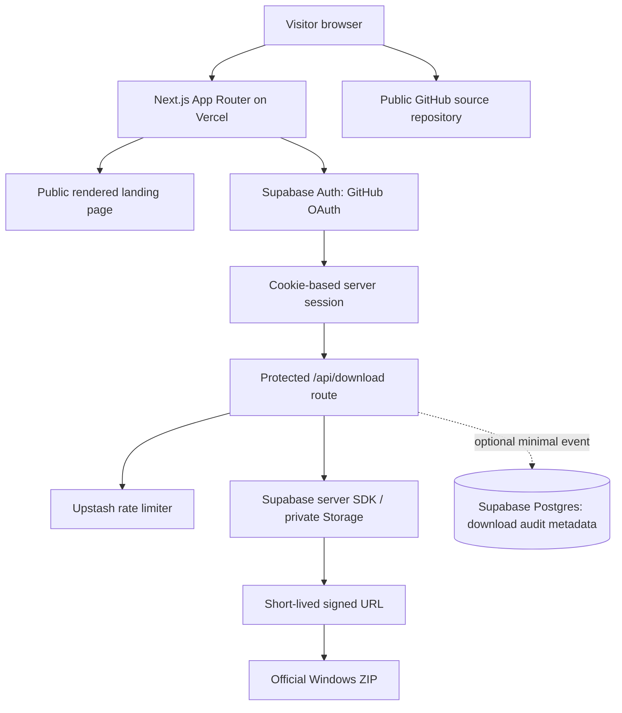

# Website Architecture

## 1. System boundary

This is a **separate public website and download portal** for RECALL. It is not the RECALL runtime and does not store the engine's memory data.

The existing RECALL application remains Python + FastAPI + MCP, with SQLite as canonical persistence and ChromaDB as derived semantic search state. Do not merge that database architecture into the website.

## 2. Recommended high-level architecture

Vercel Firewall provides an edge protection layer before app routes where the deployed plan/config supports the desired rules. Supabase's built-in Auth rate limits remain enabled. Turnstile may be added to public forms or sign-up if abuse appears.

## 3. Application layers

- `app/(marketing)/page.tsx`: public page; server-rendered content and public metadata.
- `app/login/`: sign-in UI and explanatory states.
- `app/auth/callback/route.ts`: validate the OAuth code and establish the cookie-backed session.
- `app/api/download/route.ts`: server-only authorization and URL generation / redirect.
- `app/privacy/` and `app/terms/`: public policy pages when the site collects account or analytics data.
- `app/sitemap.ts`, `app/robots.ts`, `app/opengraph-image.tsx` or static equivalent: search/share metadata routes.
- `components/`: brand/navigation/hero/features/footer and reusable UI components.
- `lib/supabase/`: browser and server clients using supported Supabase SSR patterns.
- `lib/security/`: rate limiter, origin/redirect validation, and request helpers.
- `lib/releases/`: single source for the current artifact version and private storage path; do not scatter version strings.

This is a proposed organization. First inspect the checked-out repository and adapt it rather than forcing a duplicate project structure over existing files.

## 4. Data boundaries

Website Supabase stores only auth-provider/user records managed by Supabase and minimal website-specific data if needed. It must not receive RECALL's local SQLite database, ChromaDB index, coding-agent transcripts, memory contents, custom instructions, or source snippets.

Optional `download_events` table (only if approved):
- `id` UUID primary key;
- `user_id` UUID references `auth.users`;
- `release_version` text;
- `created_at` timestamp with time zone;
- `status` constrained enum/text for requested/issued/failed.

Avoid storing raw IP addresses, full user-agent strings, tokens, or signed URLs. If an abuse investigation truly requires a network identifier, document retention and hash/minimize it.

Enable RLS on application tables. Normal browser clients should not be able to insert arbitrary events or read other users' records. Prefer inserting download audit events from the trusted server after authorization.

## 5. Release artifact boundary

- The official ZIP resides in a **private** Supabase Storage bucket if the official website download should require sign-in.
- The server route uses a server-only credential only where needed to sign the URL; never return that credential to the browser.
- Use a short-lived URL (initial proposal: 120 seconds) and treat it as a bearer secret until expiry.
- The public Git repository and MIT source license can remain public. If a public GitHub Release asset contains the same ZIP, it bypasses the website gate. Put only source/public docs on the public path if meaningful binary gating is required.

## 6. Failure modes

- Supabase Auth unavailable: do not issue a download URL; show a retryable error.
- Missing/invalid session: redirect to login with a validated internal return path.
- Upstash unavailable: for protected download URL issuance, fail closed with a safe retryable error rather than silently disabling throttling; other public content remains available.
- Private artifact missing: log a safe server-side diagnostic; show an actionable “release temporarily unavailable” message.
- Signed URL expired: request a new URL after validating the session and rate limit.
- Analytics/Sentry unavailable: do not break core page, authentication, or download behavior.
- RECALL local service unavailable: no effect on the landing page; it is not a remote runtime dependency.

## 7. Architecture decisions

- Next.js App Router is preferred for server routes, crawlable content and a simple Vercel deployment. If an existing landing-page codebase is already started in Vite, audit conversion cost before rewriting; do not migrate just for trend reasons.
- Supabase is an identity/storage service for this website, not a replacement for RECALL's local canonical memory architecture.
- Use a single protected download route. Avoid client-side exposure of storage credentials or direct admin access.
